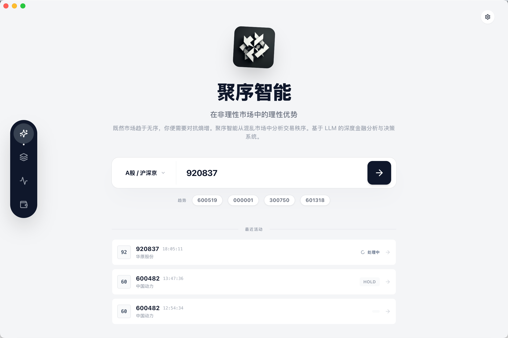
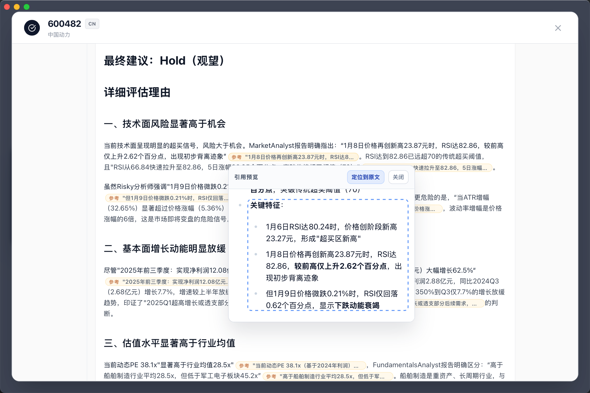
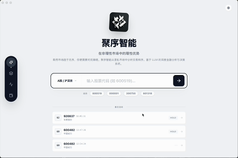
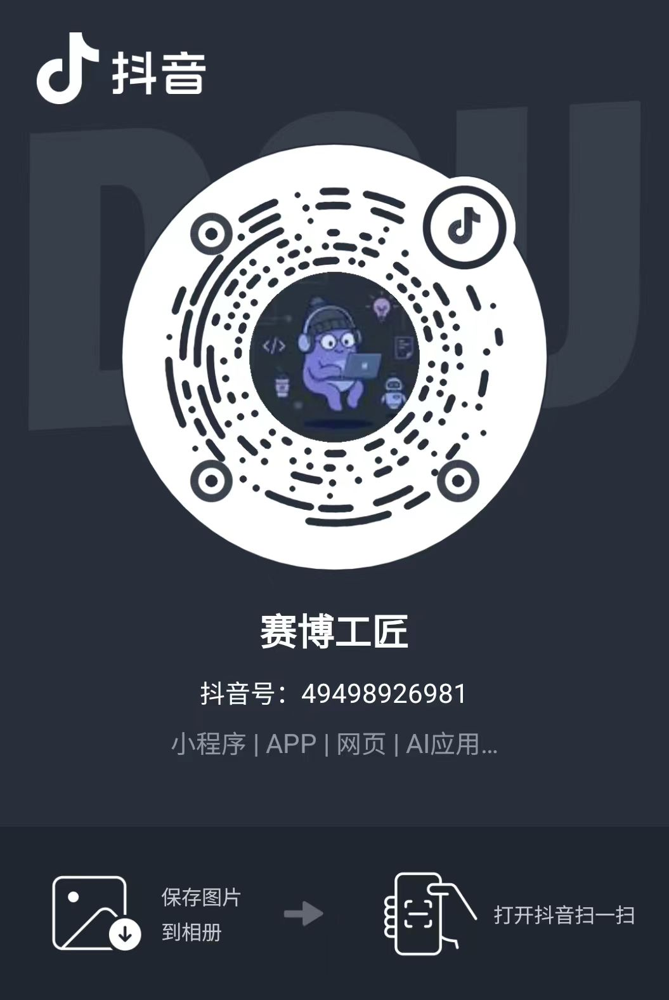
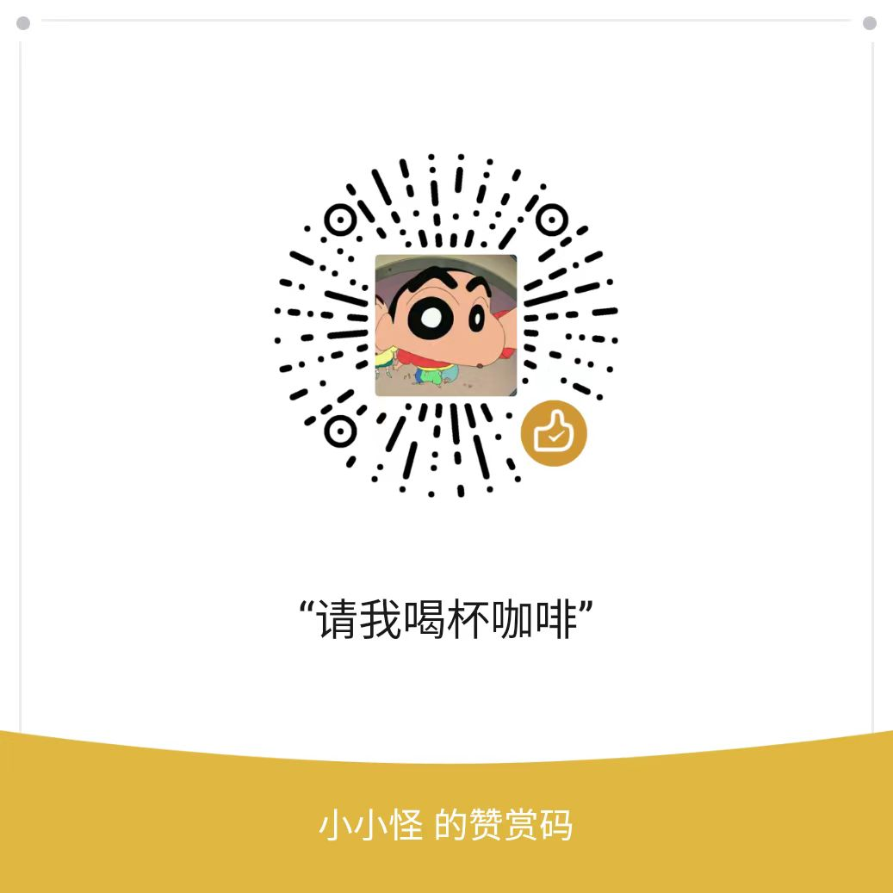

<p align="center">
  
</p>
<h1 align="center">Syntropy（聚序智投）</h1>
<p align="center">
  一个面向真实工作流的「多 LLM 团队投研」桌面应用：让分析、辩论、证据校验、报告生成变得可追溯、可回放、可实时观看。
</p>
<p align="center">
  <a href="../../releases/latest">下载最新版本</a>
  ·
  <a href="#本地体验开发者">本地开发</a>
  ·
  <a href="#风险提示">风险提示</a>
</p>
<p align="center">
  
  
  
  
  <a href="https://github.com/pytauri/pytauri/"></a>
</p>

本项目的整体团队化设计思路参考了 [TradingAgents](https://github.com/TauricResearch/TradingAgents) (感谢 Tauric Research 团队的研究)
使用 [Agno](https://github.com/agno-agi/agno) 来落地多智能体编排与运行时  

## 目录

- [下载安装包](#下载安装包)
- [预览](#预览)
- [核心能力](#核心能力)
- [技术栈](#技术栈)
- [本地体验（开发者）](#本地体验开发者)
- [许可证](#许可证)
- [联系方式](#联系方式)
- [风险提示](#风险提示)

## 下载安装包

- GitHub Releases：[下载最新版本](../../releases/latest)

> 普通用户可以直接下载安装包使用。

如果觉得这个项目对您有帮助，请给我一个 Star ⭐️ 谢谢。

## 预览
<table>
  <tr>
    <td width="50%"><b>首页</b></td>
    <td width="50%"><b>证据溯源（点击参考直接查看来源）</b></td>
  </tr>
  <tr>
    <td></td>
    <td></td>
  </tr>
  <tr>
    <td colspan="2"><b>流式报告（实时输出）</b></td>
  </tr>
  <tr>
    <td colspan="2"></td>
  </tr>
</table>


## 核心能力

### 1) 团队化投研工作流（灵感来自 TradingAgents）

[TradingAgents](https://github.com/TauricResearch/TradingAgents) 对投研组织的抽象（分析师团队 → 多空研究员辩论 → 风控/交易决策）非常贴近真实流程。我们将其作为设计灵感与参考文献，在此基础上独立实现了一套可落地的桌面工作流与工程体系。

### 2) 用 Agno 完成多智能体编排

我们用 [Agno](https://github.com/agno-agi/agno) 组织 Agents/Teams/Workflows，并利用其运行时特性把「长耗时、可流式、可观测」的投研任务跑起来

### 3) 引入“证据校验层”，降低幻觉论证

为了避免 LLM 在辩论时“虚空索敌”，引用一个有理但虚假的证据。

在研究员辩论（多空论点交锋）环节上，我们引入了证据校验层：

- 对辩论论点的证据做校验与过滤，剔除无效/弱相关证据
- 显著降低“看似有理但无来源”的幻觉论证

### 4) 代码级证据溯源：报告里的每条引用都可点击

我们还在代码层面对 LLM 的证据做溯源：报告中每个论点的证据（参考链接）都可以直接点击打开引用来源，并可用于回放/复核。

对低可信证据，我们会在报告中标记出来，提醒用户注意。

### 5) 报告流式输出：实时看到输出与进度

报告是流式输出的，你可以在任务运行过程中实时看到各团队产出、工具调用、阶段性结论与最终报告逐步成形。可以直播式的观察整个过程，而不是等待任务完成后才查看。

## 技术栈

- 桌面容器：Tauri v2
- 前端：Vue 3 + TypeScript + Vite + TailwindCSS
- 后端：PyTauri（Python）+ Pydantic（IPC 数据模型）+ Agno（多智能体框架）+ akshare (获取股票数据) + crawl4ai (获取新闻数据)

## 许可证

本项目采用 GNU Affero General Public License v3.0 (AGPL-3.0) 许可。

如果对项目感兴趣需商用授权或定制开发，请联系我（见下方联系方式）。

## 联系方式

- 微信：xxg-2077 (请备注来意)
- 邮箱: chung2077@163.com

<details open>
<summary>在抖音关注我</summary>

抖音号: 49498926981



</details>

<details open>
<summary>☕️ 赞助</summary>

如果这个项目对你有帮助，欢迎赞助支持持续迭代：

[请我喝杯咖啡 https://ifdian.net/a/chung-207](https://ifdian.net/a/chung-2077)



</details>

## 本地体验（开发者）

```bash
npm install
npm run tauri dev
```

## 风险提示

本项目仅用于学习与研究，不构成任何形式的投资建议、投资咨询、荐股服务、个股推荐、交易指令、要约或承诺，亦不保证任何收益或结果。  
本软件包含由大语言模型（LLM）自动生成的内容，不同 LLM/不同版本/不同提示词与上下文可能导致输出质量与稳定性存在显著差异；LLM 亦可能产生“幻觉”（编造/误解事实、来源、数据或结论），输出可能不完整、过时或存在错误。  
请务必基于权威渠道对关键事实、数据与引用来源进行独立核验，并结合自身风险承受能力独立决策；因使用本软件进行交易/投资决策所产生的一切风险与损失由使用者自行承担，必要时请咨询持牌专业人士。
